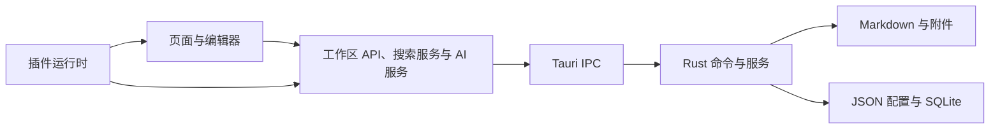

# Snippets Code

Snippets Code 是一个本地优先的代码片段与 Markdown 笔记工作台，使用 Vue 3、TypeScript 和 Tauri 2 构建。它面向需要整理常用代码、开发笔记和技术资料的开发者，将内容编辑、全文检索和桌面快捷操作放在同一个应用中。

片段和笔记保存在工作区的 Markdown 文件中，可以用外部编辑器修改，也可以通过 Git 同步插件进行版本管理。截图、翻译、录屏、应用启动器和本地 AI 等能力通过可安装插件提供。核心内容管理可在本地使用；插件下载、模型下载、在线翻译、联网搜索和更新检查会按相应功能访问网络。

当前支持 Windows 桌面，发布流程使用 NSIS 生成安装包。系统主题、截图和录屏等模块依赖 Windows API，macOS 和 Linux 尚未提供对应支持。

## 目录

- [功能特性](#功能特性)
- [技术栈](#技术栈)
- [安装与配置](#安装与配置)
- [使用方法](#使用方法)
- [代码结构与模块依赖](#代码结构与模块依赖)
- [数据存储与同步](#数据存储与同步)
- [开发与验证](#开发与验证)
- [贡献指南](#贡献指南)
- [相关文档](#相关文档)
- [许可证](#许可证)

## 功能特性

### 工作区与内容编辑

- 创建或选择 Markdown 工作区，并在设置中切换当前工作区。
- 以文件夹组织分类，管理标签、收藏和内容排序；已删除内容可以从本机回收站恢复。
- 代码片段使用 CodeMirror 6，提供语法高亮、编辑器搜索和代码复制。
- Markdown 笔记使用 TipTap，提供可视化编辑、阅读与源码模式，以及表格、任务列表、代码块和图片支持。
- 支持 `[[笔记标题]]` 形式的 Wikilink、大纲和反向链接，便于组织相关笔记。
- 通过文件监听更新外部编辑器产生的修改。语言、框架、片段类型等内容元数据保存在 Markdown Frontmatter 中。

### 搜索与桌面操作

- 使用全局快捷键唤起搜索窗口，也可以在主窗口中打开快速搜索。
- 检索工作区内容，结合中文分词、模糊匹配、拼音和使用历史排序展示结果。
- 通过插件接入应用、浏览器书签、桌面文件、搜索引擎和计算工具。
- 支持键盘选择和执行结果；搜索服务对插件来源设置超时，部分来源失败时仍可返回其他结果。
- 提供工作台概览、系统托盘、自定义快捷键、开机启动和应用更新功能。
- 支持简体中文、英文，以及浅色、深色和跟随系统的应用主题。

### 官方插件

官方功能插件与主程序分别发布。是否出现相应页面、设置项或快捷键，取决于插件是否已安装并启用。

| 插件 ID | 主要能力 |
| --- | --- |
| `git-sync` | 工作区 Git 初始化、拉取、推送、自动同步、历史与冲突处理 |
| `local-launcher` | 本地应用与浏览器书签管理、搜索和启动 |
| `desktop-files` | 桌面文件索引与搜索 |
| `search-engines` | 自定义搜索引擎、关键词快捷搜索和默认搜索入口 |
| `quick-tools` | 搜索框中的计算、单位换算和实时汇率换算 |
| `screenshot` | 区域截图、标注、取色、贴图、OCR 和截图翻译 |
| `screen-recorder` | 区域录屏、剪辑及 MP4、GIF 导出 |
| `translation` | Google、Bing、离线模型和本地 AI 翻译，以及选中文本翻译 |
| `local-ai` | 基于 llama.cpp 与 GGUF 模型的本地对话、翻译和编辑辅助；支持将 AI 回复保存为笔记 |
| `todo` | 待办卡片、定时提醒和通知 |
| `system-theme` | Windows 系统主题切换、定时及日出日落切换 |
| `wallpaper-switcher` | 本地壁纸轮换与 Wallhaven 在线壁纸 |

以下依赖来自当前插件包清单。通过插件市场安装时，应用会递归安装清单中的依赖；资源包与模型的准备是不同步骤。

| 功能插件 | 清单声明的依赖 |
| --- | --- |
| `screenshot` | `screenshot-rapidocr`、`translation`、`local-ai` |
| `translation` | `translation-offline-runtime` |
| `local-ai` | `local-ai-llama-runtime` |
| `screen-recorder` | `screen-recorder-ffmpeg` |

OCR、FFmpeg 和 llama.cpp 等运行资源通过资源包分发，不随核心安装包统一内置。离线翻译和本地 AI 还需要准备对应模型。

## 技术栈

下表列出当前依赖声明采用的主要版本系列。具体约束与锁定版本分别见 [package.json](package.json)、[pnpm-lock.yaml](pnpm-lock.yaml)、[Cargo.toml](src-tauri/Cargo.toml) 和 [Cargo.lock](src-tauri/Cargo.lock)。

| 层级 | 技术 | 用途 |
| --- | --- | --- |
| 前端 | Vue 3.5、TypeScript 5.6、Vite 6 | 页面、类型检查与前端构建 |
| 状态与路由 | Pinia 2、Vue Router 4 | 应用状态、窗口内路由和插件页面 |
| UI 与样式 | Element Plus 2、Tailwind CSS 3、SCSS | 公共组件、布局与主题变量 |
| 编辑器 | TipTap 3、CodeMirror 6、Shiki 4 | Markdown 编辑、代码编辑与高亮 |
| 国际化 | Vue I18n 11 | 简体中文与英文界面 |
| 桌面后端 | Tauri 2、Rust 2021 edition、Tokio | IPC、窗口、托盘、快捷键与后台任务 |
| 数据 | SQLite / rusqlite、Serde JSON / YAML | 持久状态、来源索引、配置及 Frontmatter |
| 文件与检索 | notify、walkdir、jieba-rs、fuzzy-matcher、pinyin、Rayon | 文件监听、目录扫描、分词与搜索 |
| 验证与规范 | Vitest、ESLint、Stylelint、Prettier、Cargo test / Clippy | 单元测试、静态检查与格式化 |

前端通过 Tauri IPC 调用本地 Rust 命令，应用运行不需要另行部署 Web 服务。Git 同步使用系统 Git；本地 AI 使用独立的 llama-server 进程。

## 安装与配置

### 安装发布版本

从仓库的 [Releases](https://github.com/GigaPuddings/snippets-code-t/releases) 下载 Windows 安装程序，安装后启动应用并完成首次设置。直接使用安装包不需要 Node.js 或 Rust；使用 Git 同步时需要系统 Git。

### 从源码运行

开发环境需要：

| 依赖 | 要求 |
| --- | --- |
| Windows 工具链 | MSVC C++ 构建工具与 Windows SDK；桌面运行需要 WebView2 |
| Node.js | `^20.19.0` 或 `>=22.12.0`，与 `package.json` 的 `engines` 一致 |
| pnpm | CI 使用 pnpm 9；安装依赖时使用仓库锁文件 |
| Rust | stable 工具链，Windows 使用 MSVC target；仓库未声明最低 Rust 版本 |
| Git | 克隆源码及 Git 同步使用 |

仓库中的 `.nvmrc` 和 `.node-version` 目前仍固定为 `18.18.2`，与 `package.json` 不一致。使用版本管理工具时，应手动选择符合 `engines` 的 Node.js 版本；`.npmrc` 启用了 `engine-strict`。

```bash
git clone https://github.com/GigaPuddings/snippets-code-t.git
cd snippets-code-t
pnpm install --frozen-lockfile
pnpm tauri dev
```

`pnpm tauri dev` 会启动 Vite 开发服务和 Rust 桌面程序。Vite 使用固定端口 `1420`。`pnpm dev` 只启动前端服务，涉及文件系统、窗口或其他 Tauri IPC 的功能应在桌面程序中验证。

可以使用 `pnpm tauri info` 检查本机的桌面开发环境。

### 首次设置

1. 选择界面语言，并选择新建工作区或使用已有工作区。
2. 确认应用数据目录。Windows 默认路径由程序所在目录计算，也可以选择可写的自定义位置。
3. 选择 Markdown 工作区。默认位置为用户文档目录下的 `Snippets Code Workspace`，用户文档目录不可用时回退到用户主目录。
4. 确认插件安装目录。默认插件包位于应用数据根目录下的 `packages/plugins`，也可以单独设置位置。
5. 完成设置并重启后，在设置中配置快捷键、主题与所需插件。

应用数据目录、Markdown 工作区和插件安装目录分别承担不同职责。实际路径可以在“设置 → 数据管理”中查看。

### 配置插件与模型

在“设置 → 插件”中安装或更新插件。当前市场安装流程要求先安装 `git-sync`，再安装其他插件；使用工作区同步前，还需要在个人中心配置 Git 仓库与连接信息。

对于需要本地运行资源的插件：

- 截图 OCR 需要 RapidOCR 资源；截图翻译还依赖翻译能力。
- 录屏需要 FFmpeg 资源。
- 离线翻译需要 Transformers.js / ONNX WASM 运行资源及翻译模型。
- 本地 AI 需要 llama.cpp 运行资源与 GGUF 模型。在插件设置中选择模型目录、模型和运行程序；使用图像能力时还需适配模型的视觉投影文件。

源码开发时，仓库提供以下可选下载命令：

```bash
pnpm rapidocr:install
pnpm ffmpeg:install
```

下载内容分别放在 `src-tauri/resources/rapidocr` 和 `src-tauri/resources/ffmpeg`，用于开发回退路径，已被 Git 忽略。它们不是核心启动或普通编译的前置步骤。

### 构建

验证前端与桌面程序能否编译，可以使用与 CI 相同的命令：

```bash
pnpm tauri build --debug --no-bundle
```

生成发布安装包：

```bash
pnpm tauri build
```

前端产物位于 `dist/`，默认 Rust 编译产物位于 `src-tauri/target/`，NSIS 安装包位于 `src-tauri/target/release/bundle/nsis/`。

当前配置启用了更新签名产物。执行发布打包前需要设置 `TAURI_SIGNING_PRIVATE_KEY`，以及密钥需要密码时的 `TAURI_SIGNING_PRIVATE_KEY_PASSWORD`。只检查编译时可使用上面的 `--no-bundle` 命令。主程序构建与官方插件运行时构建相互独立。

## 使用方法

### 保存和复用代码片段

在工作区创建分类，例如 `TypeScript`，再新建代码片段，填写标题、内容和标签。例如保存以下函数，标题设为“去除数组重复项”：

```typescript
export function unique<T>(items: T[]): T[] {
  return [...new Set(items)];
}
```

完成编辑后，通过搜索窗口输入“去除数组重复项”或内容关键词找到该片段。打开后可以复制选中代码，也可以使用代码编辑器菜单中的“复制全部”。

### 连接相关笔记

创建名为“Vue 组件约定”的笔记，再在另一篇笔记中写入：

```markdown
## 组件开发

实现组件前先查看 [[Vue 组件约定]]。

- [ ] 确认输入参数
- [ ] 补充使用示例
```

点击 Wikilink 可定位相关笔记，反向链接面板用于查看引用关系。需要直接调整 Markdown 时，可以切换到源码模式；也可以使用外部编辑器修改工作区文件。

### 使用搜索插件

启用 `local-launcher` 后，可以按名称搜索本机应用和浏览器书签；启用 `desktop-files` 后，桌面文件也会进入结果。上下方向键选择结果，回车执行对应操作。

启用 `search-engines` 后，可以为搜索引擎配置关键词及包含 `%s` 的 URL 模板。若关键词设为 `g`，在搜索框输入 `g Vue watch` 即可使用该引擎检索 `Vue watch`。

启用 `quick-tools` 后，可在搜索框输入算式，例如 `1 + 2 * 3`，或单位换算表达式。汇率换算需要访问在线汇率数据。

### 同步工作区

安装并启用 `git-sync`，在个人中心配置远程仓库，再使用拉取和推送同步内容。插件提供自动同步和冲突处理；具体同步范围见下文及[跨设备数据同步文档](docs/DATA_SYNC.md)。

### 将 AI 回复保存为笔记

安装并配置 `local-ai` 后，从标题栏进入 AI 对话，确认模型服务可用再发送消息。对需要保留的回复使用“保存为笔记”，内容会写入当前 Markdown 工作区，并保留问题、会话、模型等来源信息。操作与更新边界见 [AI 回复保存为笔记](docs/AI_REPLY_CAPTURE.md)。

## 代码结构与模块依赖

### 目录结构

```text
snippets-code-t/
├── src/
│   ├── main.ts、App.vue         # 前端初始化与根组件
│   ├── router/、layout/         # 核心路由、布局与标题栏
│   ├── pages/                  # 搜索、配置、首次设置、更新等核心页面
│   ├── components/             # 公共 UI、编辑器、分类与设置组件
│   ├── api/                    # 工作区、配置、插件、AI 等 IPC 调用
│   ├── store/                  # 配置、布局、主题、热键及插件状态
│   ├── hooks/、composables/     # 搜索、文件监听和公共交互逻辑
│   ├── search/                 # 统一搜索服务、来源注册表与排序
│   ├── workbench/              # 工作台能力、概览与视图模型
│   ├── ai/                     # AI provider、上下文、流式请求与偏好
│   ├── plugins/                # 插件协议、宿主桥与官方插件前端源码
│   ├── types/、utils/           # 共享类型、转换、校验与工具
│   └── i18n/、styles/、assets/  # 语言、主题及静态资源
├── src-tauri/
│   ├── src/
│   │   ├── lib.rs、app_setup.rs # Tauri 入口、状态与启动编排
│   │   ├── commands/           # 工作区、文件系统和应用命令
│   │   ├── markdown/           # 文件、Frontmatter、索引、监听与回收站
│   │   ├── db/                 # 核心状态库、来源索引库及数据操作
│   │   ├── app_config/         # 配置持久化、插件安装、校验与资源管理
│   │   ├── plugins/            # 官方插件的 Rust 后端适配
│   │   ├── git_sync/           # Git 命令、应用服务、仓库与冲突处理
│   │   ├── sync_data.rs        # 可移植同步数据与配置投影
│   │   └── window.rs、hotkey.rs、tray.rs 等
│   ├── capabilities/          # Tauri 窗口与 API 权限配置
│   ├── resources/             # 可选本地运行资源说明与开发回退目录
│   ├── nsis/                  # Windows 安装及卸载相关配置
│   └── Cargo.toml、tauri.conf.json
├── plugin-registry/
│   ├── marketplace/           # 应用读取的插件市场索引
│   ├── packages/              # 官方插件清单与构建后的前端运行时
│   └── examples/              # 示例插件与资源包模板
├── scripts/                   # 插件构建、资源下载与发布校验脚本
├── docs/                      # 架构、数据、UI 与插件开发文档
├── .github/workflows/         # CI 检查与 Windows 发布流程
├── public/                    # Vite 公共资源
├── AGENTS.md                  # 仓库维护约定
├── package.json、pnpm-lock.yaml
└── README.md
```

前端测试与被测模块放在相邻的 `*.test.ts` 文件中；Rust 测试由 Cargo 运行。`app_config.rs` 和 `git_sync.rs` 仍承担兼容门面职责，具体逻辑已分拆到同名目录。

### 核心模块

| 模块 | 主要入口 | 依赖与职责 |
| --- | --- | --- |
| 应用启动与窗口 | `src/main.ts`、`src/router/index.ts`、`src-tauri/src/lib.rs`、`src-tauri/src/app_setup.rs` | 前端挂载状态、路由和主题；后端初始化数据库、工作区、监听器、托盘与快捷键 |
| 工作区与编辑器 | `src/api/fragment.ts`、`src/api/markdown.ts`、`src/components/TipTapEditor/`、`src/components/CodeMirrorEditor/` | 通过 IPC 调用 Rust 工作区及 Markdown 命令；文件系统是内容事实源 |
| 统一搜索 | `src/hooks/useSearch.ts`、`src/search/`、`src-tauri/src/markdown/index_optimized.rs` | 合并 Markdown 检索与启用插件的搜索源，再去重、排序并处理超时；使用历史来自核心状态库 |
| 插件平台 | `src/store/plugins.ts`、`src/plugins/`、`src-tauri/src/app_config/` | 加载安装包清单与运行时，注册页面、设置、搜索源、热键、标题栏和 AI 能力；后端负责包管理及执行门禁 |
| AI 能力层 | `src/ai/`、`src/api/localAi.ts`、`src/plugins/local-ai/` | 按能力选择 provider，收集工作区、选区等上下文；现有本地 provider 调用 Rust 管理的 llama-server |
| Git 同步 | `src/plugins/git-sync/`、`src-tauri/src/git_sync/`、`src-tauri/src/sync_data.rs` | 使用系统 Git 同步白名单内容与可移植配置；拉取后刷新内容并导入配置 |



文件监听器将外部变更更新到缓存和搜索索引，再通过事件通知前端。插件运行时负责能力注册，安装与启用状态决定其路由、设置和搜索来源是否可用。插件权限还需要与宿主桥、后端白名单和 `src-tauri/capabilities` 配置协调。

## 数据存储与同步

| 数据 | 当前存储位置与用途 |
| --- | --- |
| 片段与笔记 | 工作区中的 `.md` 文件，Frontmatter 保存 UUID、标题、标签、类型及其他内容元数据 |
| 内容附件 | 工作区内的附件文件；相对路径与存储规则由附件设置控制 |
| 应用配置 | `<data-root>/.snippets-code/app.json` |
| 工作区布局 | `<workspace>/.snippets-code/workspace.json` |
| 文件元数据缓存 | `<workspace>/.snippets-code/cache.json`，用于文件状态和索引维护 |
| 核心持久状态 | `<data-root>/core.db`，包括搜索历史、用户配置及插件用户数据 |
| 可重建来源索引 | `<data-root>/search.db`，包括应用、书签、桌面文件和图标等派生数据 |
| 插件持久状态 | `<data-root>/state/plugins/<plugin-id>/`；具体介质按插件实现区分 |
| 默认插件包 | `<data-root>/packages/plugins/<plugin-id>/`，可设置独立安装目录 |
| 数据目录指针 | 平台应用数据目录中的 `path.json`，用于定位自定义数据根 |

`<data-root>` 是应用数据根目录，`<workspace>` 是当前 Markdown 工作区，两者可以分开。内容文件、不可丢失的用户状态和可重建索引具有不同生命周期；重建索引不等同于重置应用或备份数据。

Git 同步只提交允许的 Markdown、被引用的受管附件和同步协议文件，并投影部分通用偏好、快捷键及工作区设置。SQLite 数据库、索引缓存、本机绝对路径、Git 凭据、插件包和模型不属于同步范围。新设备仍需配置本机路径与连接信息，并安装插件、准备模型。

完整备份需要覆盖工作区与应用持久数据。手动复制数据目录时，应先退出应用，避免只复制正在写入的 SQLite 主文件而遗漏 WAL 数据。存储、迁移与清理边界见[数据存储与管理](docs/DATA_MANAGEMENT.md)。

## 开发与验证

在仓库根目录执行前端检查：

```bash
pnpm typecheck
pnpm test
pnpm lint
pnpm lint:style
```

在 `src-tauri` 目录执行后端检查：

```bash
cargo clippy --all-targets -- -D warnings
cargo test
```

CI 在 Linux 上执行前端检查，在 Windows 上执行 Rust 检查和桌面编译。仅通过前端构建不足以验证原生窗口、快捷键或插件后端行为。

### 官方插件开发

先检查 `src/plugins` 的已有能力和相近插件。官方前端源码位于 `src/plugins/<plugin-id>`，安装清单位于 `plugin-registry/packages/<plugin-id>/plugin.json`；插件市场索引为 `plugin-registry/marketplace/marketplace.json`。

插件通过宿主能力接口注册工作区访问、存储、搜索、AI、网络、剪贴板、通知和窗口等能力。新增后端行为时，同时检查插件启用状态、命令权限和后端门禁。完整接入与独立发布流程见[官方插件开发](docs/OFFICIAL_PLUGIN_DEVELOPMENT.md)。

相关本地命令：

```bash
pnpm plugins:build-official
pnpm plugins:package
node scripts/verify-plugin-marketplace.mjs --local
```

运行时构建会更新官方插件包中的 `dist/` 和入口声明；打包输出在 `dist-plugin-packages/`。验证后清理本次生成的临时产物，不要提交 OCR、FFmpeg、llama 或模型二进制。插件版本与主程序版本独立维护，发布脚本的仓库映射位于 `scripts/plugin-release-config.mjs`。

## 贡献指南

提交修改前请阅读 [AGENTS.md](AGENTS.md) 和[编码规范](docs/CODING_STANDARDS.md)。

1. 对较大功能先通过 Issue 说明使用场景、现有行为和拟修改范围；问题报告附上系统、应用及插件版本、复现步骤和相关日志。
2. Fork 仓库，在自己的开发分支完成修改，并复用现有组件、composable、API 和插件接口。
3. 为行为变更补充与风险相称的测试，运行相关检查。主题与公共 UI 修改需验证浅色、深色、系统主题和现有交互状态。
4. 更新受影响的文档、i18n 文案、插件清单或配置迁移。插件、快捷键和后端权限变化应检查完整调用链。
5. 使用 Conventional Commits 提交，例如 `fix(search): handle provider timeout` 或 `docs: update setup instructions`。可使用 `pnpm commit` 交互填写；提交信息由 Commitlint 检查。
6. 提交 Pull Request，说明问题、最终行为、验证结果和兼容性影响。提交前检查 `git status --short`，排除无关改动与临时文件。

## 相关文档

- [数据存储与管理](docs/DATA_MANAGEMENT.md)：数据目录、持久状态、索引、迁移与清理。
- [跨设备数据同步](docs/DATA_SYNC.md)：Git 同步范围、恢复流程和配置冲突。
- [AI 回复保存为笔记](docs/AI_REPLY_CAPTURE.md)：笔记来源及主程序与插件的更新边界。
- [工作台架构](docs/DEVELOPER_WORKBENCH.md)：工作区、统一搜索、插件平台和 AI 能力层。
- [架构文档](docs/ARCHITECTURE.md)：架构说明及模块设计背景。
- [插件系统](docs/PLUGIN_SYSTEM.md)：插件协议、能力、权限和生命周期。
- [官方插件开发](docs/OFFICIAL_PLUGIN_DEVELOPMENT.md)：接入、构建与独立发布。
- [公共 UI 样式](docs/UI_STYLE_GUIDE.md)：主题变量、公共组件和 Markdown 排版。
- [原生窗口设计](docs/WINDOW_CONTENT_FIT_AND_PASSTHROUGH.md)：窗口尺寸、透明区域及鼠标穿透。
- [更新记录](RELEASE_NOTES.md)：版本变更。

## 许可证

本项目采用 [Apache License 2.0](LICENSE)。第三方运行资源与模型的许可条款以各自项目为准。
